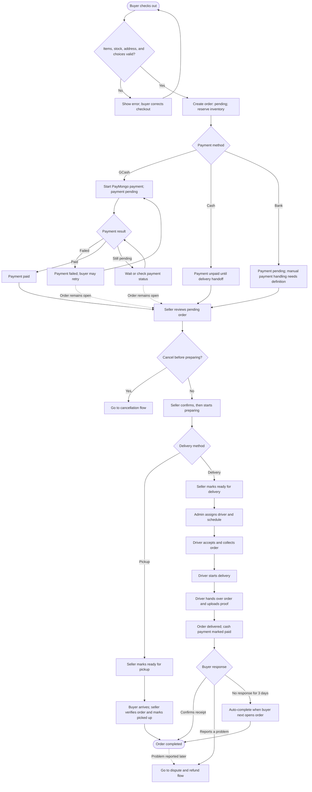
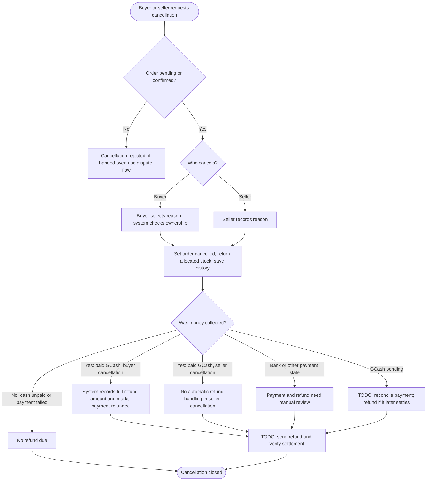
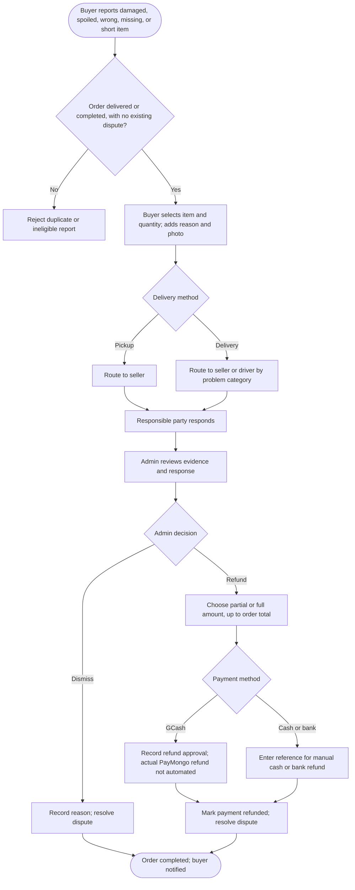

# AgriVerse order process flowchart

This maps the order behavior currently represented in the backend and database migrations, and labels the steps still needed to complete refunds. **Order status** and **payment status** are separate: an order can be `cancelled` while a payment still needs attention.

## 1. Place and fulfill an order

## 2. Cancellation from either side

**Current limitation:** The buyer cancellation function marks paid GCash as `refunded` and sets `refunded_at`, but makes no PayMongo refund call. Seller cancellation restores inventory but has no equivalent refund step. The `refunded` label therefore does not prove the buyer received money.

Seller confirmation is not currently blocked by a pending or failed payment. A GCash payment can also settle after cancellation, so the pending-payment branch needs explicit reconciliation.

## 3. Problem after delivery or pickup

**Decision points to define before implementing a complete refund workflow:** who executes and verifies GCash refunds, how bank payments are confirmed, whether pickup cash is marked paid at handoff, what happens if payment succeeds after cancellation, and when `payment_status = refunded` should be set. A safer target is `refund requested → approved → sent → confirmed`, with a transaction reference and failure/retry handling before showing the buyer that a refund is complete.

## Source of current behavior

- [Buyer orders](../backend/routes/buyer-orders.js) — checkout, buyer cancellation, delivery confirmation, disputes, and 3-day auto-completion.
- [Seller orders](../backend/routes/seller-orders.js) and [pickup migration](../supabase/migrations/031_pickup_order_flow.sql) — seller status changes and pickup branch.
- [Driver orders](../backend/routes/driver-orders.js) — delivery handoff, proof, and cash payment status.
- [Admin deliveries](../backend/routes/admin-deliveries.js) — dispute resolution and refund recording.
- [Buyer cancellation migration](../supabase/migrations/027_buyer_order_cancellation.sql) — buyer cancellation and inventory restoration.
- [PayMongo webhook](../backend/routes/paymongo-webhook.js) — GCash payment success and failure updates.
